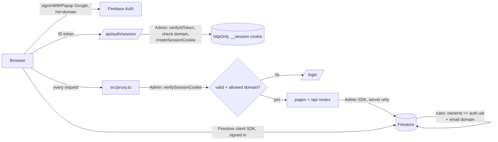

# Implementation Plan

> Turns the findings in [SYSTEM_ANALYSIS.md](./SYSTEM_ANALYSIS.md) into ordered, PR-sized work.
> Finding IDs (S1, C1, …) refer to that document. Each PR should leave `npx tsc --noEmit` passing and must not add new `npm run check:system` errors.

---

## 0. Decisions

### Resolved (2026-10-27)

| # | Decision | Outcome |
|---|---|---|
| D1 | **Access control** | **Google sign-in (Firebase Auth), limited to company accounts.** Each user's pipeline (leads, campaigns, emails) is private to their account. The team library is shared (Q2) |
| D2 | **Scheduler** | **A free external scheduler calls one secured endpoint.** No Vercel cron dependency (see §1) |
| D3 | **"Not Interested" replies** | **One-click confirmation.** The AI proposes, the user confirms. Only `BOUNCE` and `OUT_OF_OFFICE` are applied automatically |
| D4 | **Sequence engines** | One engine in `src/lib/sequenceEngine.ts`. Both existing URLs become thin wrappers, then are retired |
| Q1 | **Allowed sign-in domain** | `easyio.tech` only (`ALLOWED_EMAIL_DOMAINS=easyio.tech`) |
| Q2 | **What is shared** | **Shared team library:** products, templates, signatures, sequences. Any `@easyio.tech` user can read, create and edit them; each doc records `createdBy` and `updatedBy`. **Private per user:** leads, campaigns, emails, notifications, settings (which include each user's chosen default signature) |
| Q3 | **Owner of existing data** | `faheem@easyio.tech`. The backfill assigns all existing private records to this account, and marks it as the admin in `ADMIN_EMAILS` |
| Q4 | **Repo visibility** | **Public.** GitHub Actions minutes are free and unlimited, so the scheduler can run every 15 minutes. Secrets must only ever live in GitHub/Vercel secret settings (history scan on 2026-10-27: no keys found) |

> "Sequences" were not named explicitly; they are treated as shared because they reference shared templates and work like templates. Each campaign still chooses which sequence to use. Switch them to private if that's wrong.

---

## 1. Free scheduler options

The engine becomes one endpoint, `GET /api/cron/run`, protected by `Authorization: Bearer $CRON_SECRET`. Any scheduler that can send an HTTP request with a header can call it, so the choice can change later without code changes.

| Option | Cost | Frequency | Pros | Cons |
|---|---|---|---|---|
| **GitHub Actions `schedule`** *(chosen)* | Free and unlimited for **public** repos (this one). A private repo would get 2,000 min/month, with each run billed as at least 1 minute | Every 15 min is fine on a public repo | Lives in the repo, secret stored in GitHub Secrets, run history visible, no new account | Start times are best-effort (can be delayed several minutes under load). **On public repos, scheduled workflows are auto-disabled after 60 days without repo activity**, so the workflow re-enables itself (see below) and `cronRuns` staleness is shown on the dashboard |
| **cron-job.org** | Free | Down to every minute | Precise timing, failure email alerts, simple UI | Third-party account holds the cron secret |
| **Firebase scheduled Cloud Functions** | Needs the **Blaze** (pay-as-you-go) plan with a card. At this volume, usage normally stays inside the free quota (Cloud Scheduler includes 3 free jobs per billing account) | Any | Same platform as the database. Could later run the engine itself | Requires a billing account, plus a separate `functions/` deploy pipeline |
| Vercel Cron (current) | Free on Hobby | Daily only on Hobby | Already configured | Too infrequent for follow-ups and send windows |

**Decision:** GitHub Actions, **every 15 minutes**, in `.github/workflows/cron.yml`. cron-job.org stays as a backup that can call the same endpoint. Remove the Vercel cron entry once the workflow is live.

Public-repo safety: the workflow only reads `secrets.*`, which GitHub never exposes to pull requests from forks. Workflow logs are public, so the curl call must never echo the secret or the response body.

```yaml
# .github/workflows/cron.yml (PR 2.3)
on:
  schedule: [{ cron: '4,19,34,49 * * * *' }]   # every 15 min, off the :00 rush
  workflow_dispatch: {}
permissions: {}
jobs:
  run:
    runs-on: ubuntu-latest
    timeout-minutes: 5
    steps:
      - run: |
          curl -fsS -o /dev/null -w "%{http_code}\n" --max-time 280 \
            -H "Authorization: Bearer ${{ secrets.CRON_SECRET }}" \
            "${{ secrets.APP_URL }}/api/cron/run"
```

To avoid the 60-day auto-disable, a small monthly job (`keepalive.yml`) re-enables both scheduled workflows, itself included, through the GitHub API (`gh workflow enable`) with `permissions: actions: write`. It runs well inside the 60-day window, so it is never disabled first. Confirm the reset behavior after the first month; if it doesn't hold, switch the trigger to cron-job.org. The dashboard also warns when the last `cronRuns` document is older than 1 hour.

Because the engine both creates and sends due emails in the same call (PR 2.2), one scheduled job covers everything.

---

## Phase 0: Hotfixes (≈1–2 days, 3 PRs, no dependency on auth)

### PR 0.1: Cron engine hotfixes (C1, C2, C3, C6)
File: `src/app/api/cron/sequences/route.ts`
- `p.id === campaign.targetProduct` → `p.name === …` (line 44).
- `currentSequenceNodeId: undefined` → `deleteField()` (lines 76, 197). `resendMessageId: … || undefined` → conditional spread (line 151).
- Condition branch `'false'` → `'No'` (line 182).
- A `try/catch` around each lead. Skip `contactStatus` `Meeting Booked` / `Not Interested`. Advance only when the send succeeded, otherwise mark the email `failed`.
- **Done when:** the `check:system` errors `PRODUCT_KEY`, `FIRESTORE_UNDEFINED` and `BRANCH_LABEL` are gone, and an email → delay(0) → end sequence sends once and completes.

### PR 0.2: Send and build fixes (C8, build, S7)
- `/api/send`: `reply_to` → `replyTo`.
- Create the Resend client lazily (`src/lib/resend.ts` → `getResend()`) so `next build` works without secrets.
- `git rm -r --cached .firebase/logs`, then add `.firebase/` to `.gitignore`. The log contains `faheem@easyio.tech` and no keys (scanned 2026-10-27). Since the repo is public, the address stays in history unless that history is rewritten; that's optional and not planned.

### PR 0.3: Inbox XSS and webhook signature (S3, S4)
- Sanitize inbound email HTML and signatures with `isomorphic-dompurify` before `dangerouslySetInnerHTML` (`inbox/page.tsx:332`, `signatures/*`).
- Verify the Resend webhook signature (Svix headers, `RESEND_WEBHOOK_SECRET`). Return 401 if it doesn't match.
- **Done when:** an inbound email containing `` renders inert, and an unsigned POST to the webhook gets 401.

> Until Phase 1 ships, the deployment stays publicly reachable. If your Vercel plan offers Deployment Protection for production, turn it on as a stopgap, exempting `/api/webhook/inbound`, `/api/track`, `/api/cron/*` and `/api/leads/import`.

---

## Phase 1: Google sign-in and per-user data (≈1–1.5 weeks, 5 PRs)

### Target design



- **Private collections** (`leads`, `campaigns`, `emails`, `notifications`) get `ownerId` (Firebase uid) and `ownerEmail`. Settings move from `settings/global` to `settings/{uid}`, which also holds that user's `defaultSignatureId`.
- **Shared collections** (`products`, `templates`, `signatures`, `sequences`) are a team library: no owner filter, and `createdBy` / `updatedBy` record who changed what. Signatures lose the global `isDefault` flag, because each user picks their own default in Settings.
- **Two layers of enforcement:** Firestore rules protect direct browser access, and API routes check the session and filter by `ownerId` with the Admin SDK.
- **Sender identity per user:** `from = "<Name> <user email>"` (works because the company domain is verified in Resend). Reply-To = `reply+<uid>@<inbound subdomain>`, so the webhook knows which user an inbound reply belongs to without guessing.

### PR 1.1: Auth foundation
New: `src/lib/firebaseAdmin.ts` (service account from `FIREBASE_SERVICE_ACCOUNT` env), `src/components/auth/AuthProvider.tsx` + `useAuth()`, `src/app/login/page.tsx`, `src/app/api/auth/session/route.ts` (POST create, DELETE logout), `src/proxy.ts`.
- Google provider with `setCustomParameters({ hd: domain })` as a hint. The **server** enforces the real rule: `email_verified && domain ∈ ALLOWED_EMAIL_DOMAINS`.
- `proxy.ts` (Next 16's replacement for `middleware`, Node runtime) verifies the session cookie. It redirects pages to `/login` and returns 401 JSON for `/api/*`. Exempt paths: `/login`, `/api/auth/*`, `/api/webhook/inbound`, `/api/track`, `/api/cron/*` (bearer secret), `/api/leads/import` (extension key).
- `src/lib/serverAuth.ts`: `requireUser(req) → { uid, email }` for route handlers.
- TopBar shows the signed-in user and a sign-out button.

### PR 1.2: Server data access through the Admin SDK
- Server routes stop importing `src/lib/firebase.ts` (the client SDK). They use `firebaseAdmin` and `requireUser`.
- Routes that write (`enrich/bulk`, `leads/import`, generation that saves) stamp `ownerId` and `ownerEmail`.
- Extension import: per-user extension keys (`extensionKeys/{hash} → uid`), generated in Settings, instead of one shared `EXTENSION_API_KEY`.

### PR 1.3: Scoped queries, rules and indexes
- Hooks for private collections (`useLeads`, `useCampaigns`, `useEmails`, `useNotifications`, `useSettings`) add `where('ownerId','==',uid)` and wait for `uid` before subscribing. Hooks for shared collections stay unfiltered. Pages that call Firestore directly (inbox, outbox, drafts, BulkCampaignDialog) move behind hooks.
- `createDocument` stamps `ownerId`/`ownerEmail` on private collections and `createdBy`/`updatedBy` on shared ones. `updateDocument` stamps `updatedBy`.
- New `firestore.rules` (deny by default; anything not listed is unreachable from the browser):
  ```
  rules_version = '2';
  service cloud.firestore {
    match /databases/{db}/documents {
      function signedIn() { return request.auth != null && request.auth.token.email_verified == true
                            && request.auth.token.email.matches('.*@easyio[.]tech$'); }
      function owns(d)    { return d.ownerId == request.auth.uid; }

      // Private, per user
      match /{col}/{id} {
        allow read, update, delete: if col in ['leads','campaigns','emails','notifications']
                                    && signedIn() && owns(resource.data);
        allow create:               if col in ['leads','campaigns','emails','notifications']
                                    && signedIn() && owns(request.resource.data);
      }
      match /settings/{uid} { allow read, write: if signedIn() && uid == request.auth.uid; }

      // Shared team library
      match /{col}/{id} {
        allow read, write: if col in ['products','templates','signatures','sequences'] && signedIn();
      }
      // locks, cronRuns, extensionKeys: server only (Admin SDK bypasses rules)
    }
  }
  ```
- New `firestore.indexes.json`: `(ownerId, createdAt desc)` on each private collection, `emails(ownerId, campaignId, createdAt)`, `emails(ownerId, leadId)`, `emails(status, scheduledAt)`, `leads(ownerId, email)`. Add the rules and index files to `firebase.json` and remove its dead `functions` entry.
- **Done when:** user A can't see user B's leads, in the UI or through a direct Firestore query from the console.

### PR 1.4: Backfill existing data
- `scripts/backfill-owner.mjs --email faheem@easyio.tech [--dry-run]` uses the Admin SDK:
  - Looks up the uid with `auth.getUserByEmail()`. **faheem@easyio.tech must sign in once (PR 1.1 deployed) before this runs.**
  - Sets `ownerId`/`ownerEmail` on every private document that has none, and `createdBy` on shared documents.
  - Copies `settings/global` → `settings/{uid}`, and turns the current `isDefault` signature into that user's `defaultSignatureId`.
- Rollout order: deploy PR 1.1 → Faheem signs in → run the backfill with `--dry-run` and check the counts → run it for real → deploy the new rules and PR 1.3. (If the rules go first, existing data becomes invisible.)
- `ADMIN_EMAILS=faheem@easyio.tech`. Admins can read the cron run log and the team-wide analytics view; they still can't edit other users' leads.

### PR 1.5: Per-user sending and reply routing
- `/api/send` gets the sender name and email from `requireUser` and `settings/{uid}`, and sets Reply-To to `reply+<uid>@…`.
- The webhook takes the owner uid from the recipient address (`reply+<uid>@`). Within that owner, it matches the lead by exact sender address (`where('ownerId','==',uid).where('email','==',addr)`). Fallback for older emails without the plus address: the most recent outbound email to that address.
- Settings page: remove the API keys section, and add "Generate extension key".

---

## Phase 2: One engine on a free scheduler (≈1 week, 4 PRs)

### PR 2.1: Shared contracts
`src/lib/contracts.ts`: `BRANCH_LABELS`, `INTENTS`, `AUTO_APPLIED_INTENTS = ['BOUNCE','OUT_OF_OFFICE']`, terminal lead and contact statuses, `SENT_STATUSES`, `findProductForCampaign()`. Used by the builder, engine, webhook, analytics and dashboard. Extend `check:system` to flag duplicated literals.

### PR 2.2: Extract the engine (Admin SDK, owner-aware)
`src/lib/sequenceEngine.ts`, `src/lib/email.ts`
- `processLead()` is a pure function that returns decisions. `runSequences()` loads due work **per owner**, applies decisions with a `writeBatch` per lead, and sends due emails inline (campaign send window and timezone via `getNextValidSendTime`; otherwise it writes `scheduled` and a later run sends it).
- Behavior: name- or id-based product lookup; `Yes`/`No` conditions that check for inbound mail since the last action; A/B variant recorded; signature and tracking pixel; terminal checks on `status`, `contactStatus` and `pendingStatus` (PR 4.2); generation and sending as direct function calls (no HTTP calls back into the app).
- **Run lock:** a `locks/sequenceRun` document with a 10-minute lease, taken in a transaction, so overlapping scheduler calls can't double-send. **Idempotency:** Resend idempotency key `= emailId`.

### PR 2.3: Single scheduled endpoint and workflow
- New `GET /api/cron/run`: checks the bearer `CRON_SECRET`, calls `runSequences()` and then sends due `scheduled` emails, sets `maxDuration`, and writes a `cronRuns` document (start, end, counts, errors).
- Add `.github/workflows/cron.yml` (§1), with repo secrets `CRON_SECRET` and `APP_URL`.
- The campaign page "Process Sequence" button calls `runSequences({ campaignId, ownerId })` through an authenticated route.
- Delete `/api/cron/sequences`, `/api/cron/process-sequences` and `/api/cron/send-scheduled`, and remove `crons` from `vercel.json`.

### PR 2.4: Tests
Add `vitest` and `"test": "vitest run"`. Cover `getNextValidSendTime`, `resolvePlaceholders`, `processLead` (every node type, terminal and pending states, seeded A/B), and the plus-address parser.

---

## Phase 3: Data accuracy (≈3–4 days, 3 PRs)

- **PR 3.1: Truthful send status (C7):** `sending` → `sent`/`failed` everywhere, show the error on a failed Inbox reply, idempotency keys from the UI.
- **PR 3.2: Opens and analytics (C9, C11):** opens set `opened` and `openedAt` only, without touching `status`. Count sent with `SENT_STATUSES`. The webhook increments campaign stats with `increment()`. Template performance is attributed by `variant` and template. `email.opened` is looked up by `resendMessageId` query instead of loading every email.
- **PR 3.3: Placeholders and classification failure (C10, C13):** one `{{snake_case}}` syntax (the resolver also accepts legacy camelCase). Remove the `[DEBUG]` bodies. When classification fails, leave the lead status unchanged and set `actionRequired:true`.

---

## Phase 4: Trustworthy AI and reply confirmation (≈1 week, 3 PRs)

### PR 4.1: Structured, validated classification
`src/lib/prompts.ts` as the single source. Gemini JSON schema output and `temperature: 0`, validated with `zod` (unknown labels → `UNKNOWN`). The email is passed as delimited data. Each email stores `aiProvider`, `aiModel` and `promptVersion`.

### PR 4.2: "Not Interested" confirmation flow (D3)
- Webhook:
  - `BOUNCE` / `OUT_OF_OFFICE` → applied automatically, as today.
  - `NOT_INTERESTED` → lead gets `pendingStatus: 'lost'`, `pendingReason: <summary>`, `pendingEmailId`. **`status` is not changed.**
  - `POSITIVE_INTEREST` / `MORE_INFO_REQUESTED` → `replied` (these never remove a lead).
- The engine treats any lead with a `pendingStatus` as **paused**, so no follow-ups go out while a decision is waiting.
- Inbox:
  - A "Needs review" filter and a banner on the thread: *"AI thinks this is Not Interested: '<summary>'"*, with **Confirm** (→ `status: 'lost'`, clear pending) and **Dismiss** (→ clear pending, `status: 'replied'`, so the sequence stays stopped).
  - Badge count in the TopBar.
- Analytics: track confirm and dismiss rates, as a live measure of classifier precision.

### PR 4.3: Grounded generation and model config
- Grounding clause in all generation prompts. Rewrite the Guides presets so they no longer ask for invented metrics, name-drops or compliance claims. Add `Product.proofPoints[]` as the only allowed source of proof.
- `src/lib/claimCheck.ts` (ported from `run-evals.mjs`) shows warnings in Compose before sending.
- Model list from env (`FALLBACK_MODEL`, `FALLBACK_MODELS`). Per-attempt timeouts.
- Run `npm run eval` on a preview deploy and commit the baseline to `evals/results/`. **Gates:** intent accuracy ≥ 0.85, 0 invalid labels, 100% on injection cases.

---

## Phase 5: Code health and CI (ongoing)

- GitHub Actions on every PR: `tsc`, `check:system`, `test`, `build`. `eval` on PRs labelled `ai-change`.
- Clear the lint backlog, then add `lint` to CI.
- Finish or remove the half-built notifications and `PendingActionsNotifier` (the "Needs review" badge from PR 4.2 can replace it).
- Replace the root `SYSTEM_CONTEXT.md` and `MEMORY.md` with pointers to `docs/`. Move the `scratch/` and `test-*` scripts to `scripts/dev/`.

---

## Sequencing & effort

```
Phase 0 (hotfixes) ──► Phase 1 (auth + per-user data) ──► Phase 2 (engine + scheduler) ──► Phase 3 ──► Phase 4
Phase 5 runs alongside everything.
```

| Phase | PRs | Rough effort | Outcome |
|---|---|---|---|
| 0 Hotfixes | 3 | 1–2 days | Cron no longer broken, Inbox XSS closed, webhook signed |
| 1 Google sign-in + per-user data | 5 | 1–1.5 weeks | Only `@easyio.tech` accounts get in; private pipeline per user, shared team library |
| 2 Engine + free scheduler | 4 | ~1 week | Follow-ups run every 15 min from GitHub Actions, no double sends |
| 3 Data accuracy | 3 | 3–4 days | Send status, opens and campaign stats are correct |
| 4 AI + confirmation | 3 | ~1 week | "Not Interested" needs a click; AI output validated and grounded |
| 5 Code health and CI | ongoing | — | Regressions and doc drift caught automatically |

Phase 1 comes before the engine rewrite because the engine has to be owner-aware. Building it first would mean writing it twice.

## Test plan

| Phase | Verification |
|---|---|
| 0 | `check:system` errors for C1–C3 gone; `npm run build` with no env; XSS payload inert; unsigned webhook → 401 |
| 1 | An `@easyio.tech` account can sign in and a personal Gmail is rejected. Two test users can't see each other's leads, campaigns or emails, in the UI or through direct Firestore reads, but both see the same products, templates, signatures and sequences. API routes return 401 without a session. After the backfill, faheem@easyio.tech sees all the existing data |
| 2 | `npm test`; a manual run of the `workflow_dispatch` workflow; two overlapping calls produce one send; the `cronRuns` document records counts |
| 3 | Send, open and reply to a test email: one sent count, `opened:true` with the status unchanged, campaign `replied` incremented |
| 4 | A "Not Interested" reply creates a pending review and pauses the sequence; Confirm marks the lead lost; Dismiss keeps it. `npm run eval` meets the gates |
