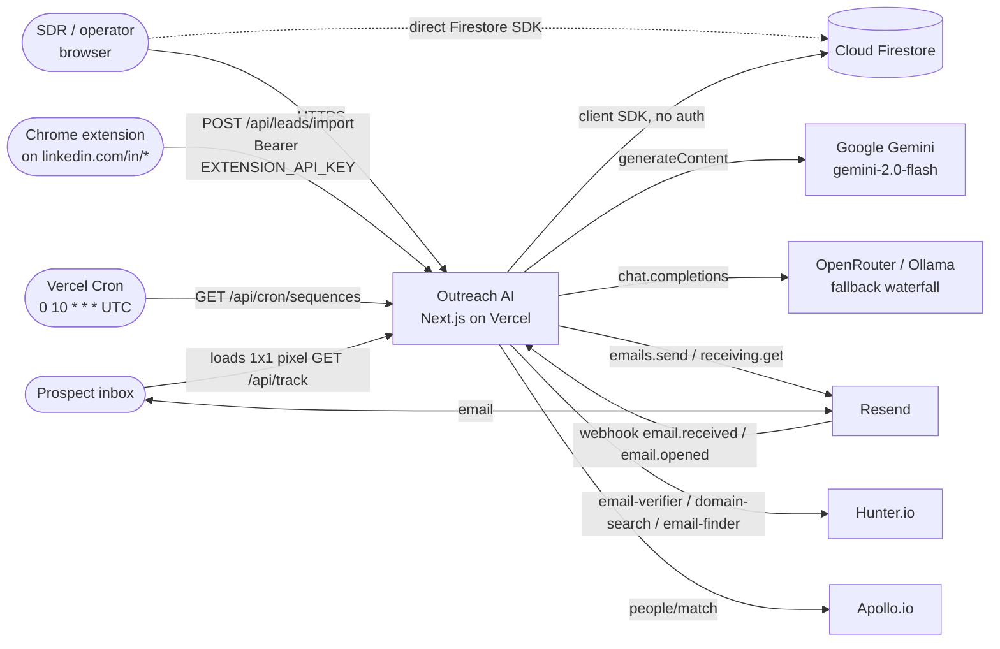
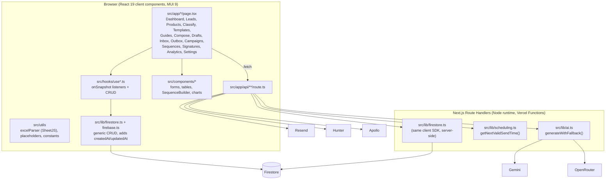
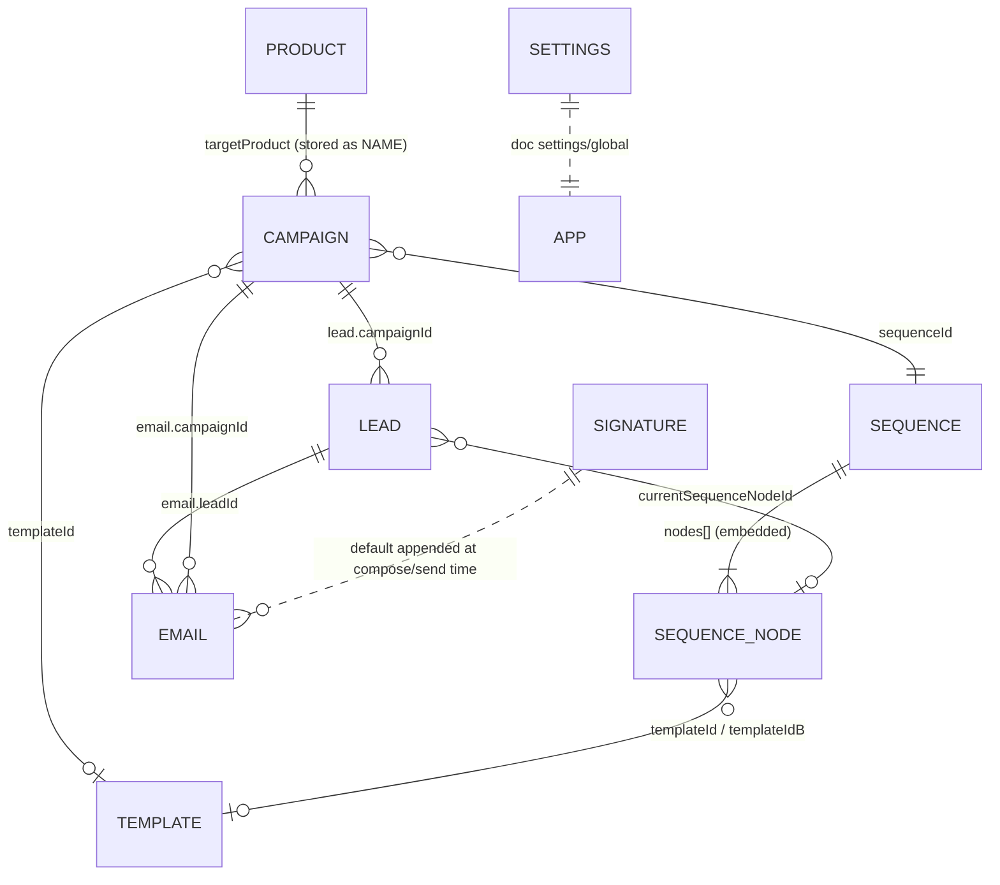
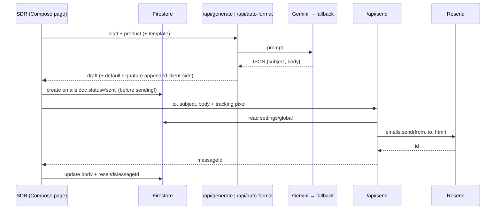
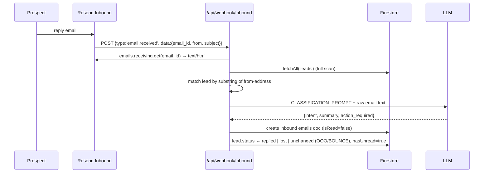
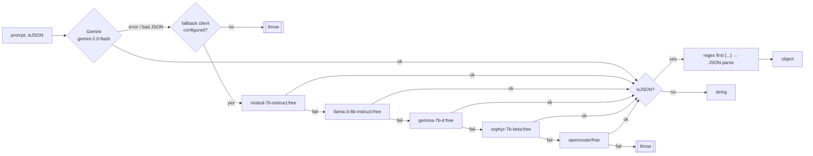

# System Architecture: Outreach AI CRM (as built)

> **Scope:** describes the code on `main` as of 2026-10-26 (commit `d0bfee2`). Everything here was traced from source. Where intent and implementation differ, this document describes the **implementation** and links to [DRIFT_REPORT.md](./DRIFT_REPORT.md).
> **Verify with:** `npm run check:system`. It fails if this file names an API route that does not exist.

---

## 1. One-paragraph summary

Outreach AI is a **single-tenant, unauthenticated Next.js 16 (App Router) app** for B2B cold outreach. The browser does most of the work: React client components read and write **Cloud Firestore directly** through the Firebase **client** SDK (no Admin SDK anywhere). A thin set of Next.js **Route Handlers** under `src/app/api/*` hold the secrets and call third parties: **Gemini** (with an OpenRouter-compatible fallback) for generation and intent classification, **Resend** for sending and receiving email, and **Hunter/Apollo** for enrichment. Automation runs in **two separate, inconsistent sequence engines**. One is invoked daily by Vercel Cron and the other manually from the campaign page. A **Chrome MV3 extension** scrapes LinkedIn profiles into the CRM.

---

## 2. System context (C4 level 1)

**Trust boundaries (important):**
- **Google sign-in is required** (`src/proxy.ts`): every page and API route needs a valid Firebase session cookie (`__session`) for an allowed domain (`ALLOWED_EMAIL_DOMAINS`, e.g. `easyio.tech`). Public exceptions authenticate callers themselves: `/api/webhook/inbound` (Resend signature), `/api/cron/sequences` (`CRON_SECRET`), `/api/leads/import` (extension key), `/api/auth/session` (Google ID token) and `/api/track` (tracking pixel, intentionally open). Sessions are minted by `/api/auth/session` from a fresh Google sign-in. Missing configuration fails closed (503).
- Stored HTML (inbound email bodies, signatures) is rendered only through `sanitizeHtml()` (DOMPurify), enforced by the `UNSANITIZED_HTML` system check.
- The browser holds the Firebase web config and talks to Firestore directly. The app only works if **Firestore security rules allow unauthenticated read/write**, so the database is effectively public. See [SYSTEM_ANALYSIS.md §4](./SYSTEM_ANALYSIS.md#4-security-posture).

---

## 3. Containers & modules (C4 level 2)

### 3.1 Directory map

| Path | Role |
|---|---|
| `src/app/layout.tsx`, `components/layout/*` | Root layout, MUI ThemeRegistry, Sidebar (14 nav items), TopBar (notification bell) |
| `src/app/<feature>/page.tsx` | All UI pages are `'use client'`. Detail/editor pages use `[id]` with `new` as a sentinel for create |
| `src/app/api/**/route.ts` | 13 route handlers (see §5) |
| `src/hooks/use*.ts` | One hook per collection: real-time `onSnapshot` plus create/update/delete helpers |
| `src/lib/firebase.ts` | `initializeApp` + `getFirestore` (client SDK). Used by browser **and** server |
| `src/lib/firestore.ts` | `fetchAll`, `fetchOne`, `createDocument`, `updateDocument`, `deleteDocument` |
| `src/lib/ai.ts` | Gemini first, then a 5-model OpenAI-compatible fallback waterfall, plus JSON extraction |
| `src/lib/scheduling.ts` | Timezone- and send-window-aware next send time (date-fns-tz) |
| `src/types/index.ts` | Domain types: `Lead`, `Campaign`, `EmailTemplate`, `Sequence`/`SequenceNode`, `Email`, `Product`, `AppNotification`, `AppSettings`, `Signature` |
| `src/utils/excelParser.ts` | Client-side XLSX/CSV lead import with fuzzy header matching (only `email` is required) |
| `src/utils/placeholders.ts` | `{{snake_case}}` placeholder list and resolver |
| `extension/` | Chrome MV3 popup and content script for LinkedIn scraping |
| `vercel.json` | One cron: `GET /api/cron/sequences` daily at 10:00 UTC |
| `firebase.json` | Declares a `functions/` codebase **that does not exist** in the repo |
| `scratch/`, `test-*.mjs/js`, `list-models.mjs` | Ad-hoc connectivity scripts (not tests) |

---

## 4. Data model (Firestore, schemaless)

| Collection | Written by | Notable fields | Notes |
|---|---|---|---|
| `leads` | UI hooks, XLSX import, `/api/leads/import`, `/api/enrich/bulk`, webhook, cron engines, inbox | `status` (pipeline), `contactStatus` (free text: "First Contact", "Follow Up N", "Meeting Booked", ...), `campaignId`, `currentSequenceNodeId`, `sequenceLastActionAt`, `hasUnread` | Two parallel status fields. Engines disagree on which one is terminal (§6.3) |
| `campaigns` | UI | `targetProduct` (**product name**, not id), `templateId`, `sequenceId`, `timezone`, `scheduleWindow{startHour,endHour,days[]}`, `status`, `stats{}` | `stats.sent` is only incremented by `/api/cron/send-scheduled`. `replied`/`positive`/... are shown in the UI but never written (always 0) |
| `sequences` | `SequenceBuilder` | `rootNodeId`, `nodes[]{id,type,templateId,templateIdB,abTestEnabled,delayDays,conditionType,children[{branchLabel,nodeId}]}` | Branch labels written: `Next Step`, `Yes`, `No` |
| `templates` | UI, AI template generator | `subject`, `body` (HTML), `category`, `placeholders[]` | AI-generated templates use `{{firstName}}` while the resolver expects `{{first_name}}` |
| `emails` | compose, inbox, campaign "Run", both engines, webhook, tracking pixel | `direction`, `status` (`draft/scheduled/sent/delivered/opened/failed`), `intent`, `intentSummary`, `actionRequired`, `variant`, `opened`, `isRead`, `resendMessageId`, `scheduledAt`, `sentAt` | Single collection for outbound and inbound |
| `products` | UI | `name`, `description`, `valueProposition`, `targetAudience`, `keyFeatures[]`, `competitorDifferentiators` | The only grounding context given to the LLM |
| `signatures` | UI | `htmlContent`, `isDefault` | Default is appended in compose and in the cron engine |
| `notifications` | `useNotifications` (no server writer) | `title`, `message`, `type`, `isRead` | Nothing in the codebase creates notifications |
| `settings/global` | `useSettings` (auto-creates) | `profile{name,email,company,senderEmail,replyToEmail}`, `apiKeys{resendApiKey,geminiApiKey}` | `/api/send` reads `profile` server-side. `apiKeys` are stored but **never used** |

Timestamps are mixed: `Timestamp.now()` (lib), `serverTimestamp()` (inbox, process-sequences), JS `Date` (cron/sequences, track) and an ISO **string** (webhook `openedAt`). Readers defensively handle `.toMillis()`/`.seconds`/`new Date()`.

---

## 5. API surface

| Route | Method | Auth | Called by | What it does |
|---|---|---|---|---|
| `/api/auth/session` | POST, DELETE | Google ID token + same-origin check | Login page, sign-out | Creates or clears the `__session` cookie (5 days) for a verified Google account on an allowed domain |
| `/api/classify` | POST | session | Classify page (single and bulk) | Intent prompt → `generateWithFallback(json)` → returns `{intent, summary, action_required}` unvalidated |
| `/api/generate` | POST | session | Compose, Campaign "Run" (engines call `generateEmail()` directly) | Resolves `{{snake_case}}` placeholders. If product context exists, asks the LLM to polish into `{subject, body}` |
| `/api/auto-format` | POST | session | Compose and Campaign "Run" when no template | Writes a fresh email from lead and product context (<150 words) |
| `/api/generate-template` | POST | session | TemplateEditor ("AI generate"); Guides presets route to `/templates/new?preset=` | Writes a template using `{{firstName}}`-style placeholders |
| `/api/send` | POST | session | Compose, Inbox reply, engines | Resend `emails.send`. `from` = `settings.profile.senderEmail` or a fallback. Reply-To = `settings.profile.replyToEmail` (as `replyTo`). The Resend client is created on first use (`src/lib/resend.ts`) |
| `/api/track` | GET | none (public pixel) | 1×1 pixel in sent HTML | Sets `emails/{id}` `opened=true`, `status='opened'` (fire-and-forget) |
| `/api/webhook/inbound` | POST | Resend (Svix) signature, `RESEND_WEBHOOK_SECRET`; fails closed if unset | Resend webhooks | `email.opened` → mark opened. `email.received` → fetch body, match lead, classify, store inbound email, update `lead.status` and `hasUnread` |
| `/api/enrich` | POST | session | LeadForm "auto-fill" | Local Firestore → Hunter email-verifier → Apollo people/match |
| `/api/enrich/bulk` | POST | session | BulkCompanyDialog | Hunter domain-search (limit 10) → creates leads (`targetProduct: 'Default'`) |
| `/api/leads/import` | POST | `Bearer EXTENSION_API_KEY` | Chrome extension | Finds the email via Hunter or Apollo if missing, otherwise a placeholder `unknown_<ts>@needs-enrichment.com`. Creates the lead |
| `/api/cron/sequences` | GET | `Bearer CRON_SECRET` if set | Vercel Cron (daily) | **Engine B**, see §6.3 |
| `/api/cron/process-sequences` | POST | session | Campaign page "Process Sequence" button | **Engine A**, see §6.3 |
| `/api/cron/send-scheduled` | POST | session | **nothing** (no UI, no cron) | Sends `emails` with `status=='scheduled' && scheduledAt<=now`, increments `campaign.stats.sent` |

Server code never calls the app's own API over HTTP: the engines and `send-scheduled` call `generateEmail()` / `sendEmail()` from `src/lib/email.ts`, which `/api/generate` and `/api/send` also wrap. Enforced by the `INTERNAL_HTTP_CALL` system check.

---

## 6. Key runtime flows

### 6.1 Manual compose and send

If Resend fails, the doc stays `status:'sent'`. The UI shows an error but analytics count it as sent.

### 6.2 Inbound reply and AI routing

Routing table: `POSITIVE_INTEREST`/`MORE_INFO_REQUESTED`/`UNKNOWN`/any other label → `replied`; `NOT_INTERESTED` → `lost`; `BOUNCE`/`OUT_OF_OFFICE` → unchanged. If the LLM call fails, the default is `UNKNOWN` → `replied`.

### 6.3 Sequence automation: two engines

| Aspect | **Engine A** `/api/cron/process-sequences` (manual button) | **Engine B** `/api/cron/sequences` (Vercel Cron, daily) |
|---|---|---|
| Trigger | POST from campaign page, optional `?campaignId` | GET daily 10:00 UTC |
| Product lookup | `p.name === campaign.targetProduct` ✅ | `p.name === campaign.targetProduct` ✅ (fixed) |
| Email node | Generates → creates `status:'scheduled'` at `getNextValidSendTime()` | Generates → creates `status:'sent'` → sends immediately (ignores schedule window/timezone) |
| Who sends scheduled mail | `/api/cron/send-scheduled`, which **nothing calls** | itself |
| A/B variant | ignored (always `templateId`) | 50/50 `Math.random()`, records `variant` |
| Signature + pixel | not added | added |
| Condition node | Looks for inbound email since last action → `Yes`/`No` branch | Assumes "no reply" (replied leads are filtered out) → follows the `No` branch (fixed) |
| Terminal-lead filter | `contactStatus` Meeting Booked/Not Interested, `status==='lost'` | `status` in replied/qualified/lost/converted, `contactStatus` Meeting Booked/Not Interested, or `sequenceCompletedAt` set (fixed) |
| End / invalid node | no-op | clears the node with `deleteField()` and sets `sequenceCompletedAt`; a failing lead no longer aborts the run (fixed) |
| Lead status update | `status:'contacted'`, `contactStatus` → "First Contact"/"Follow Up N" | `status:'contacted'` only on first touch |

**Net effect today:** after `fix/cron-engine-hotfixes`, Engine B sends and walks sequences correctly, but only once a day and ignoring send windows; a failed send marks the email `failed` and retries on the next run. Engine A queues emails that stay `scheduled` forever unless someone POSTs `/api/cron/send-scheduled` by hand. Details and fixes are in [SYSTEM_ANALYSIS.md §3](./SYSTEM_ANALYSIS.md#3-correctness-defects-verified).

### 6.4 LinkedIn extension import

`popup.js` checks the active tab is `linkedin.com/in/*` → messages `content.js` (injected on demand) → scrapes `h1`, `.text-body-medium`, `[aria-label^="Current company"]`, and About → `POST {backendUrl}/api/leads/import` with `Authorization: Bearer <apiKey>` from `chrome.storage.sync`. `host_permissions` cover `localhost:3000` and `*.vercel.app` only.

### 6.5 AI engine (`src/lib/ai.ts`)

- No timeouts, retries with backoff, temperature, or system/user role separation (the whole prompt is one user message).
- `FALLBACK_MODEL` is read but **unused**; the waterfall list is hard-coded.
- JSON extraction is greedy (`/\{[\s\S]*\}/`). The output is never checked against a schema.

---

## 7. Deployment & configuration

| Concern | Reality |
|---|---|
| Hosting | Vercel (implied by `vercel.json`, extension `*.vercel.app`) |
| Build | `next build` (Turbopack). Needs no secrets: SDK clients are created at request time (`getResend()`); CI builds with no env vars |
| Cron | Only `/api/cron/sequences`, daily `0 10 * * *` (README says hourly) |
| Firebase | Firestore only. `firebase.json` points at a non-existent `functions/` dir. No `firestore.rules` or `firestore.indexes.json` in the repo |
| Required composite index | `emails(status ==, scheduledAt <=)` for send-scheduled. Inbox, outbox, and drafts sort in memory to avoid indexes |
| Env vars (server) | `GEMINI_API_KEY`, `FALLBACK_API_URL`, `FALLBACK_API_KEY`, `FALLBACK_MODEL` (unused), `RESEND_API_KEY`, `RESEND_WEBHOOK_SECRET`, `HUNTER_API_KEY`, `APOLLO_API_KEY`, `EXTENSION_API_KEY`, `CRON_SECRET` |
| Env vars (public) | `NEXT_PUBLIC_FIREBASE_*` (6) |
| Tests / CI | None. `npm run lint` currently reports 123 problems (90 errors). `tsc --noEmit` passes |

---

## 8. Architectural characteristics

| Quality | Assessment |
|---|---|
| Simplicity | High. Few layers and generic CRUD. Easy to follow |
| Security | **Very low.** No auth, public DB, open email relay. See analysis §4 |
| Reliability | Low. Non-transactional multi-step writes, status written before send, the cron aborts on one bad lead, no idempotency (double-click = double email) |
| Scalability | Low ceiling. Full-collection scans in webhook and Engine B, sequential awaits, N+1 email queries in Engine A, no `maxDuration` on the cron route. Fine for the stated ~20–30 emails/day |
| Observability | `console.*` only. No run log, metrics, or alerting |
| Evolvability | Moderate. Typed domain model, but string-keyed contracts (branch labels, product key, placeholder syntax) drift silently. `scripts/system-checks.mjs` now guards these |
